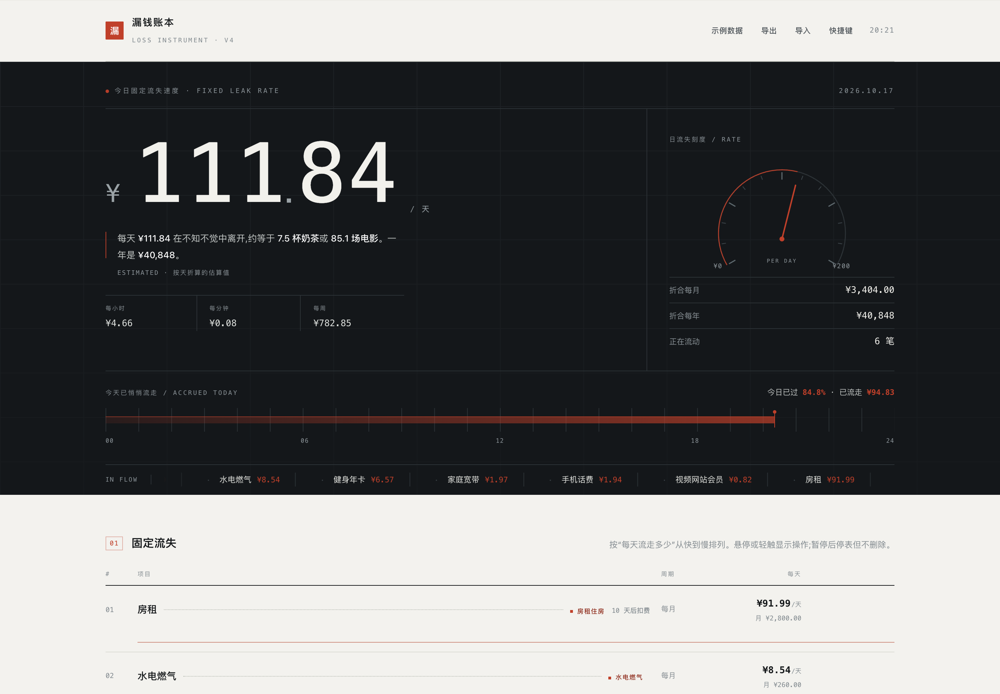

# 漏钱账本 · Loss Instrument

把会员费、话费、房租、水电这些"每月扣一次、平时想不起来"的固定开支,
折算成**每天悄悄流走多少钱**;再配上随手记的日常流水,看清一个月究竟流走了多少。

单文件、离线、零依赖。双击 `index.html` 就能用,数据只存在浏览器 localStorage 里。



## 它为什么存在

记账软件大多在问「你花了多少」。这个项目只回答一个更扎心的问题:

> **不用做任何事,每天有多少钱在自动离开你。**

所以首页不是流水列表,而是一台**测量仪**:滚轮式读数、指针量表、24 小时进程条、
按日成本排序的固定支出流。下面是账本:收据式清单、三秒快记、月度双口径汇总、
逐日与累计曲线、星期节奏。

## 功能

**测量**
- 机械滚轮式日流失读数,金额变化时滚动到位
- 指针量表(240° 弧、13 根刻度、已达成红弧,上限自动取整)
- 24 小时进程条:今天已过多少、已经流走多少
- 每小时 / 每分钟 / 每周换算,把"每天"拆到可感知的尺度
- 固定支出流跑马:每笔按期扣款一根刻度

**记录**
- 固定开支:名称、金额、类别、周期(月/季/年/单次)、下次扣费倒计时
- 日常流水:金额、日期、备注、六个消费类别,回车即存
- 负数冲销:记错了补一笔负数,曲线会如实向下拽
- 暂停/恢复、编辑、删除,全部可撤销(`⌘/Ctrl+Z`)

**复盘**
- 本月总额 = 固定折算 + 流水实付,两种口径分开算、不混用
- 构成环图、流水去向 TOP5、月底预计(估算)
- 逐日支出 + 月内累计曲线、按星期的消费节奏
- 月份自由切换,历史月份不做外推

**今日签**
- 按生日与日期做确定性哈希推算,同一天刷新结果不变
- 默认生日 1998-07-24(狮子座),可改
- 纯娱乐,不参与任何账目计算,页面上已明确声明

## 快速开始

```bash
# 方式一:直接双击 index.html(推荐,完全离线)

# 方式二:本地静态服务
python3 -m http.server 8000
# 打开 http://localhost:8000
```

首次使用可以先点右上角「示例数据」看完整形态,再「清空全部」开始记自己的账。

## 键盘

| 按键 | 作用 |
| --- | --- |
| `N` | 聚焦「随手记」金额 |
| `Enter` | 保存当前这一笔 |
| `⌘ / Ctrl + Z` | 撤回最近一次记录或删除 |
| `Esc` | 关闭弹窗 / 取消编辑 |
| `?` | 打开快捷键表 |

## 数据与隐私

- 全部数据保存在本机浏览器的 `localStorage`,**不联网、不上传、无第三方请求**;
- 存储键沿用 `leak-ledger-v1`,旧版账本与备份可直接延续;
- 导出/导入为 JSON,导入按 ID 合并去重,不覆盖现有账本;
- 读取存档与导入共用同一道消毒闸门:严格数字解析、未知枚举回退、缺失 ID 按内容哈希补齐。

换电脑或换浏览器前请先「导出」,到新环境「导入」即可。

## 测试

```bash
npm install jsdom
node tests/regression.js
```

覆盖:冷启动、示例数据、快记与撤销、固定开支增删改停、持久化、导出导入往返、
脏存档容错、`requestAnimationFrame` 缺失环境、运势模块、键盘与弹窗 —— 共 64 项断言。

开发期还使用无头 Chrome 在 1440 / 1024 / 768 / 390 四个宽度截图核对,截图见 `docs/preview/`(桌面仪器带、本月流失、流水明细、移动端首屏与清单)。

## 项目结构

```
.
├── index.html              # 完整应用(单文件:HTML + CSS + JS)
├── docs/
│   ├── DESIGN.md           # 设计说明:概念、令牌、组件、动效、可访问性
│   └── preview/            # 桌面与移动端截图
├── tests/
│   └── regression.js       # jsdom 回归测试(64 项)
├── CHANGELOG.md
└── README.md
```

## 设计

视觉上是「墨面仪器 + 纸面账本」双材质:上方深色仪器带负责测量,下方浅色纸面负责记录,
两者用一条实线硬切。单一朱红强调色,松绿只用于数据系列,等宽数字保证对齐。

细节见 [docs/DESIGN.md](docs/DESIGN.md)。

## 演进

v1 固定开支折算 → v2 流水与月度 → v3 图表与视觉重构 → v4 仪器式首屏与交互打磨。
其间修掉过若干真实缺陷(初始化顺序导致的整页失效、导入幽灵数据、脏存档污染、
栅格被跑马元素撑爆等),详见 [CHANGELOG.md](CHANGELOG.md)。

## 许可证

暂未指定开源许可证。如需 MIT 或其他许可,可在仓库中添加 `LICENSE` 文件。
